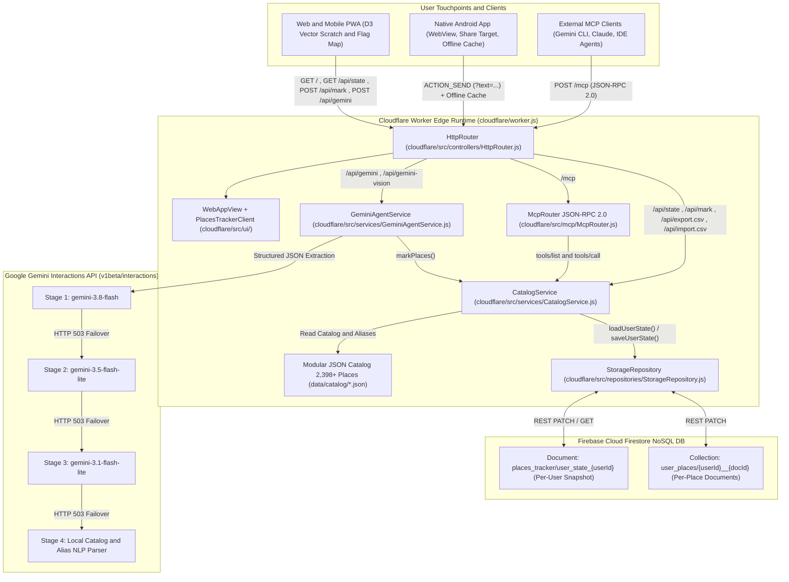
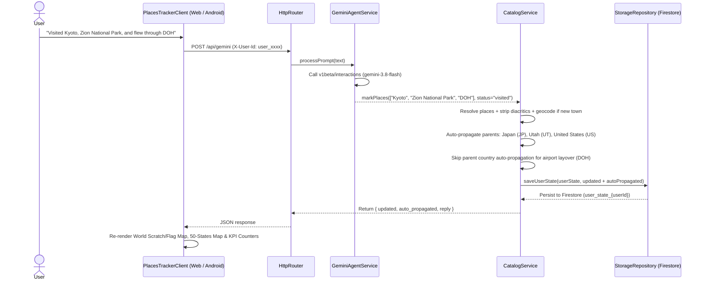

# 🌍 PlacesTracker

<p align="left">
  
</p>

An open-source, AI-powered travel tracker and interactive **Scratch & Flag Map** backed by **Google Gemini** (`v1beta/interactions`), **Firebase Cloud Firestore**, **Cloudflare Workers**, and a **Model Context Protocol (MCP) Server**.

---

## Features

- **2,398+ Pre-Seeded Places (+ Live Town Geocoding):**
  - **195** Countries + **20** Territories & Dependencies
  - **51** US States + D.C., **36** Indian States & UTs, **13** Canadian Provinces & Territories
  - **252** Commercial & Regional Airports (logging airport layovers does **not** auto-mark the parent country/state)
  - **168** National Parks, National Monuments & Wildlife Sanctuaries (all 63 US National Parks, 41 US National Monuments/Seashores, 44 Indian National Parks/Sanctuaries, plus global parks)
  - **139** UNESCO World Heritage Sites (100% of India's 43 & USA's 26 UNESCO sites + global icons)
  - **15** World Wonders
  - **1,524** US, Indian & International Cities, Suburbs & Landmarks + automatic live geocoding for 30,000+ towns worldwide
- **Smart Parent Auto-Propagation:** Marking any city, National Park, UNESCO site, or World Wonder as `visited` automatically marks its parent **Country** and **State/Province**.
- **✨ Tell Gemini (Text, Voice & Ticket Vision):** Log trips in plain English, dictate via microphone, or upload a boarding pass screenshot / `.ics` calendar file.
- **Interactive Vector Maps:** Switch between **Scratch Map** and **Flag Map** across World, US 50-States, and category checklists.
- **Multi-Tenant User Isolation:** Each browser/device generates its own isolated Sync ID (`X-User-Id`), keeping every user's travel database separate.
- **CSV Import & Export:** 1-click CSV backup and native import for both standard CSVs and *Places Been* exports (`lat;lon;country;city;been`).

---

## High-Level Design (HLD) & Architecture

### 1. System Architecture



### 2. End-to-End Request & Smart Auto-Propagation Sequence



---

## Quick Start

### 1. Local CLI & Web Dashboard (SQLite)

```bash
# View travel stats
python3 src/cli.py stats

# Mark places visited (auto-marks parent country & state)
python3 src/cli.py mark "Kyoto" "Zion National Park" "Mahabalipuram" --status visited

# Launch local web map
python3 src/cli.py serve --port 8765
```

### 2. Deploy Your Own Cloudflare Worker (Optional)

1. Set your `FIREBASE_PROJECT_ID` secret/variable and `GEMINI_API_KEY`:
   ```bash
   npx wrangler secret put FIREBASE_PROJECT_ID
   npx wrangler secret put GEMINI_API_KEY
   ```
2. Build and deploy:
   ```bash
   python3 scripts/build_worker.py
   npx wrangler deploy
   ```

### 3. Android App (Optional)

Set `<string name="web_app_url">` in `android/app/src/main/res/values/strings.xml` to your deployed URL and build via `./gradlew assembleDebug` (or use `.github/workflows/android-apk.yml`).

---

## Project Structure

```text
PlacesTracker/
├── data/catalog/          # Modular static JSON datasets (2,398+ places & schemas)
├── src/                   # Python SQLite engine, CLI & stdio MCP server
├── cloudflare/            # Cloudflare Worker (ES modules + D3 vector web app)
├── android/               # Native Android WebView & Share-from-Gemini wrapper
└── scripts/               # Worker build script (build_worker.py)
```

---

## License

MIT
