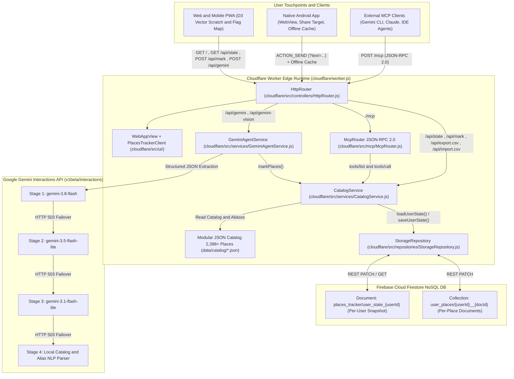
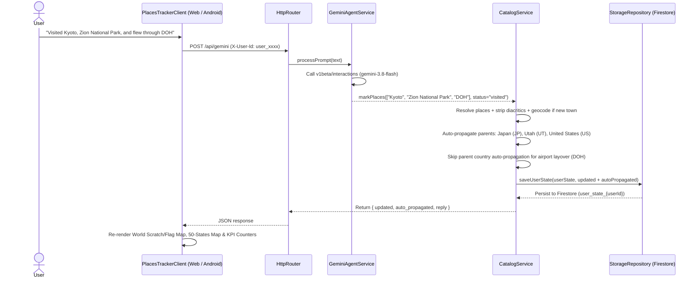

# 🌍 PlacesTracker

<p align="left">
  
</p>

An open-source, AI-powered travel tracker and interactive **Scratch & Flag Map** backed by **Google Gemini** (`v1beta/interactions`), **Firebase Cloud Firestore**, **Cloudflare Workers**, and a **Model Context Protocol (MCP) Server**.

---

## Features

- **2,398+ Pre-Seeded Places (+ Live Town Geocoding):**
  - **195** Countries + **20** Territories & Dependencies
  - **51** US States + D.C., **36** Indian States & UTs, **13** Canadian Provinces & Territories
  - **252** Commercial & Regional Airports (logging airport layovers does **not** auto-mark the parent country/state)
  - **168** National Parks, National Monuments & Wildlife Sanctuaries (all 63 US National Parks, 41 US National Monuments/Seashores, 44 Indian National Parks/Sanctuaries, plus global parks)
  - **139** UNESCO World Heritage Sites (100% of India's 43 & USA's 26 UNESCO sites + global icons)
  - **15** World Wonders
  - **1,524** US, Indian & International Cities, Suburbs & Landmarks + automatic live geocoding for 30,000+ towns worldwide
- **Derived Parent Region Auto-Propagation:** Parent **Countries** and **States/Provinces** are strictly derived from leaf places — marking any city, National Park, UNESCO site, or World Wonder as `visited` or `bucket_list` automatically updates its parent Country and State/Province.
- **✨ Gemini AI Travel Logger (Home & CSV Import Page):** Log trips in plain English, dictate via microphone, or use the **Gemini AI Travel Logger** card on the Import/Export CSV page to extract and mark places in bulk with 1-tap **✕ Remove / ↩️ Restore** undo controls and smart suffix/landmark resolution (e.g., *"Space Needle Visitor Centre"* → `Space Needle`).
- **Self-Discovering Gemini Model Cascade:** Dynamically discovers live models via `GET /v1beta/models` (cached 1h), filters out non-text modalities, and ranks general text models (`gemini-flash-latest` → `gemini-3.8-flash` → `gemini-3.6-flash` → `gemini-3.5-flash-lite` → `gemini-3.1-flash-lite` → `gemini-4-argon`) with automatic failover to the local catalog NLP parser.
- **Interactive Vector Maps & 3D Globe:** Switch between **World Map**, **Visited Regional Map** (with long-press country/state drill-down), **3D Interactive Globe**, and **My Places** category checklists.
- **Google Sign-In & Email Allowlist Security:** Built-in Google OAuth Sign-In (`GOOGLE_CLIENT_ID`) with server-side JWT verification (`oauth2.googleapis.com/tokeninfo`) and `ALLOWED_EMAILS` allowlist enforcement across `/api/*` and `/mcp`.
- **CSV Import & Export:** 1-click CSV backup (`Append` or `Override` mode) and native compatibility with *Places Been* exports (`lat;lon;country;city;been`).

---

## High-Level Design (HLD) & Architecture

### 1. System Architecture



### 2. End-to-End Request & Smart Auto-Propagation Sequence



---

## Quick Start

### 1. Local CLI & Web Dashboard (SQLite)

```bash
# View travel stats
python3 src/cli.py stats

# Mark places visited (auto-marks parent country & state)
python3 src/cli.py mark "Kyoto" "Zion National Park" "Mahabalipuram" --status visited

# Launch local web map
python3 src/cli.py serve --port 8765
```

### 2. Deploy Your Own Cloudflare Worker (Optional)

1. Configure your secrets/variables in Cloudflare Worker Settings (or via Wrangler CLI):
   ```bash
   npx wrangler secret put FIREBASE_PROJECT_ID
   npx wrangler secret put GEMINI_API_KEY
   npx wrangler secret put GOOGLE_CLIENT_ID
   npx wrangler secret put ALLOWED_EMAILS
   ```
   *(Note: `keep_vars = true` is enabled in [`wrangler.toml`](wrangler.toml) so Git deployments never overwrite variables or secrets set in your Cloudflare Dashboard).*
2. Build and deploy:
   ```bash
   python3 scripts/build_worker.py
   npx wrangler deploy
   ```

### 3. Android App & Password-Protected Signed APK (`android/`)

Set `PLACES_TRACKER_URL` in git-ignored `android/local.properties` (or as a GitHub Actions secret) and build via `./gradlew assembleDebug`. Every push to `main` automatically builds a release-signed APK (`1.0.<run_number>`) using `ANDROID_KEYSTORE_BASE64` and `KEYSTORE_PASSWORD`, locks the APK inside a password-protected archive (`PlacesTracker-Protected.zip`), and optionally delivers updates via **Firebase App Distribution** (`.github/workflows/android-apk.yml`).

---

## Project Structure

```text
PlacesTracker/
├── data/catalog/          # Modular static JSON datasets (2,398+ places & schemas)
├── src/                   # Python SQLite engine, CLI & stdio MCP server
├── cloudflare/            # Cloudflare Worker (ES modules + D3 vector web app)
├── android/               # Native Android WebView & Share-from-Gemini wrapper
└── scripts/               # Worker build script (build_worker.py)
```

---

## License

MIT
